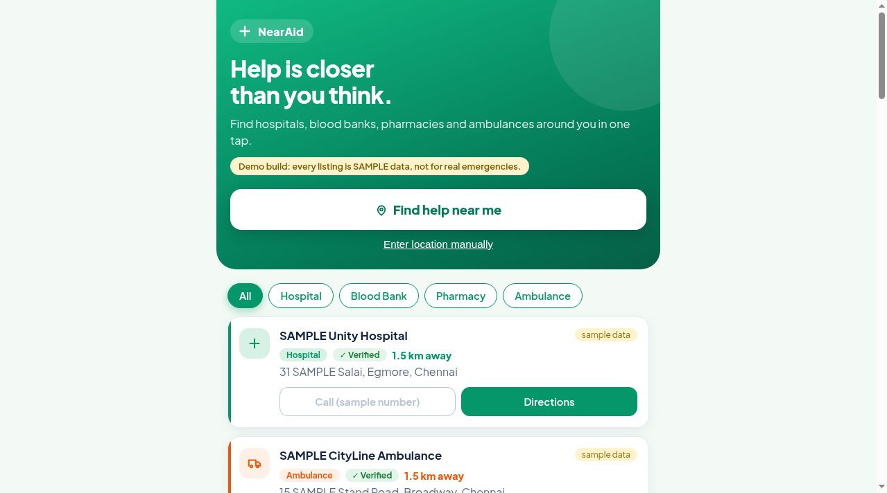
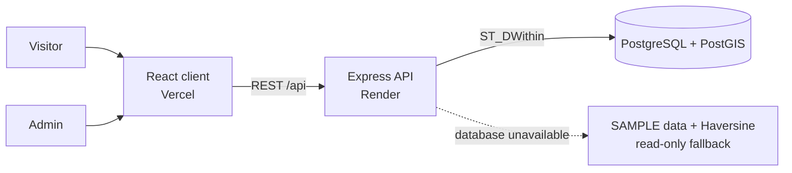

# NearAid

**Find emergency help near you** - hospitals, blood banks, pharmacies and ambulances - on a mobile-friendly website, with an admin panel to moderate community suggestions.

**Live demo:** https://nearaid.vercel.app/

> **Demo build.** Every listing is clearly labelled SAMPLE data with non-callable placeholder phone numbers. Replace them with verified data before any real use. NearAid is a student project, not an emergency service.
>
> The demo API runs on a free hosting tier, so the first search after a quiet period can take a while to respond. Open the site once before a demo.

<p align="center">
  
</p>

## Features

- **Find help near me** using the browser location, or enter coordinates manually.
- **Filter by category:** hospital, blood bank, pharmacy, ambulance.
- **Distance-ordered results** with a verified badge and a Directions link (Google Maps).
- **Call button** that is only active for real numbers; SAMPLE placeholders stay disabled.
- **Suggest a facility** - submissions are stored as `pending` until an admin reviews them.
- **Admin panel** (JWT login): review pending submissions, approve, edit or reject, and see verified facilities.
- **Last results are cached** in the browser so they can be shown again.
- **Read-only SAMPLE demo mode** when no database is reachable (used for tests and demos).

## Tech stack

| Layer | Technology |
|---|---|
| Frontend | React 18 + Vite, mobile-first |
| Backend | Node.js + Express |
| Database | PostgreSQL + PostGIS (geometry column, GiST indexes) |
| Auth | JWT + bcrypt (admin only) |
| Tests | Jest + Supertest (16 tests) |
| Hosting | Vercel (frontend), Render (API), hosted PostGIS database |

## How it fits together



## Diagrams

The design diagrams (DFD levels 0, 1 and 2, use case, conceptual class and sequence) are in [`docs/diagrams`](docs/diagrams/README.md), as images with editable sources.

| | |
|---|---|
| [DFD Level 0](docs/diagrams/images/1-dfd-level-0-context.png) | [Use case](docs/diagrams/images/4-use-case.png) |
| [DFD Level 1](docs/diagrams/images/2-dfd-level-1.png) | [Conceptual class diagram](docs/diagrams/images/5-class-conceptual.png) |
| [DFD Level 2](docs/diagrams/images/3-dfd-level-2-search.png) | [Sequence: find nearby facilities](docs/diagrams/images/6-sequence-find-nearby.png) |

These were rendered with PlantUML and Graphviz, not Sparx Enterprise Architect.

## Project layout

```
client/            React + Vite frontend (pages, components, styles)
server/            Express API
  src/             app, routes, middleware, utils (Haversine, nearby search)
  db/              schema.sql, seed data and seed script
  tests/           Jest tests
docs/
  diagrams/        DFD, use case, class and sequence diagrams (images + sources)
  images/          README screenshots
  manual-testing.md  manual end-to-end checklist
DEPLOYMENT.md      hosted setup (Supabase/Neon + Render + Vercel)
```

## Run it locally

Prerequisites: Node 18+, PostgreSQL 14+ with the PostGIS extension.

```bash
# 1. Database
createdb nearaid
psql -d nearaid -f server/db/schema.sql

# 2. Backend
cd server
cp .env.example .env      # fill PG* values, JWT_SECRET, SEED_ADMIN_*
npm install
npm run seed              # loads 30 SAMPLE facilities + creates the admin
npm run dev               # http://localhost:5000

# 3. Frontend (new terminal)
cd client
cp .env.example .env      # VITE_API_URL=http://localhost:5000 (or leave blank with the dev proxy)
npm install
npm run dev               # http://localhost:5173
```

Open http://localhost:5173, tap **Find help near me** (or append
`?lat=13.0827&lng=80.2707` to the URL to skip geolocation).

**No database?** The API automatically starts in a clearly labelled read-only
SAMPLE demo mode: searches work, but submissions and admin changes are refused
(503) and admin login stays disabled unless SEED_ADMIN_EMAIL and
SEED_ADMIN_PASSWORD are explicitly set. Never deploy this mode.

**Env tip:** quote values containing `#` or spaces in .env - dotenv strips
unquoted trailing comments (`SEED_ADMIN_PASSWORD="abc#123"`).

## Tests
```bash
cd server && npm test     # 16 tests: Haversine, nearby logic, API behaviour
```
Manual end-to-end checklist: [docs/manual-testing.md](docs/manual-testing.md)

## API reference

| Route | Auth | Description |
|---|---|---|
| `GET /api/health` | - | Service + mode (`postgis` or `fallback`) |
| `GET /api/facilities/nearby?lat&lng&type&radius` | - | Approved facilities within `radius` km (default 5, max 50), ordered by distance, `distance_km` on each row. `type` optional: hospital / blood_bank / pharmacy / ambulance |
| `POST /api/facilities` | - | Public suggestion: `{name, type, address, phone?, lat, lng}` -> stored as `pending` |
| `POST /api/admin/login` | - | `{email, password}` -> `{token}` (JWT, 2 h). Rate-limited |
| `GET /api/admin/pending` | JWT | Submissions waiting for review |
| `GET /api/admin/facilities` | JWT | Approved (verified) list |
| `POST /api/admin/facilities/:id/approve` | JWT | Approve + mark verified |
| `POST /api/admin/facilities/:id/reject` | JWT | Reject |
| `PUT /api/admin/facilities/:id` | JWT | Edit details |

Security basics: parameterized SQL everywhere, bcrypt password hashes, JWT on
admin routes, CORS restricted to the configured origin, global + login rate
limits, validated and sanitized inputs, no secrets in code.

## Why both PostGIS and Haversine

The nearby search runs in **PostGIS** in production:
`ST_DWithin(geom::geography, point, radius)` uses the functional GiST index,
so the database only touches rows near the search point, and results come back
ordered by real distance. With thousands of facilities this stays fast because
the spatial index prunes the search - that is the "PostGIS KNN at scale" story.

A plain **JavaScript Haversine** implementation serves two other jobs:

1. **Fallback mode:** when no database is reachable (demos, tests, a class
   machine without Postgres), the API still answers nearby searches from the
   in-memory SAMPLE data, clearly labelled as read-only demo mode. Haversine
   computes distance for every row - fine for 30 sample rows, too slow for
   millions, which is exactly why PostGIS is the primary path.
2. **Unit tests:** the search logic (type filter, radius limit, distance
   ordering, invalid input) is tested without needing a database.

Both paths share the same request validation and response shape, so the
frontend never cares which one answered.

## Deployment
See [DEPLOYMENT.md](DEPLOYMENT.md): Supabase/Neon (database), Render (API),
Vercel (frontend), with the exact environment variables for each.

## Sample data notice
Every seeded facility name starts with `SAMPLE` and every phone number is a
`+91-00000-000xx` placeholder that the site renders as a disabled button -
never as a callable link. Replace them with verified facilities and numbers
before any real-world use.
